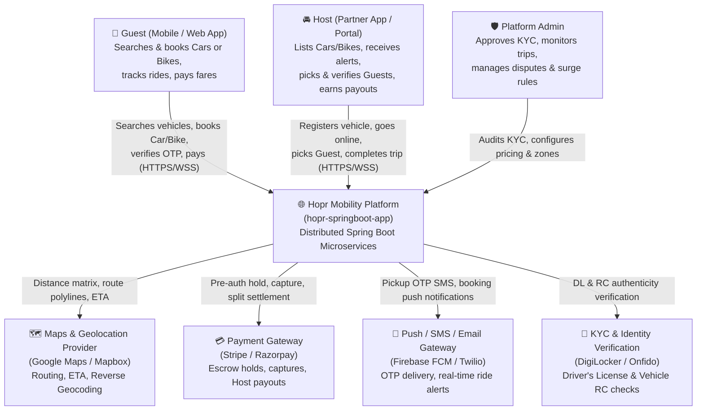
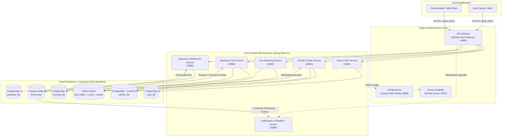
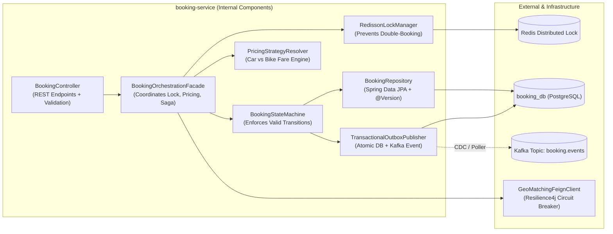
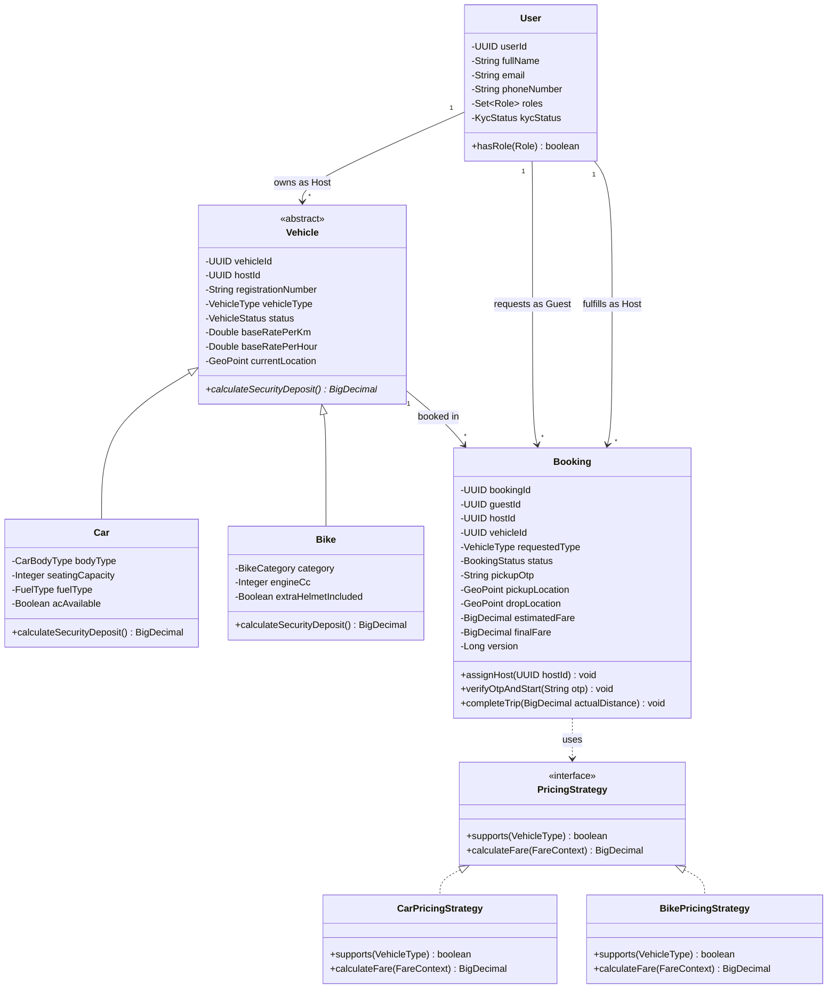
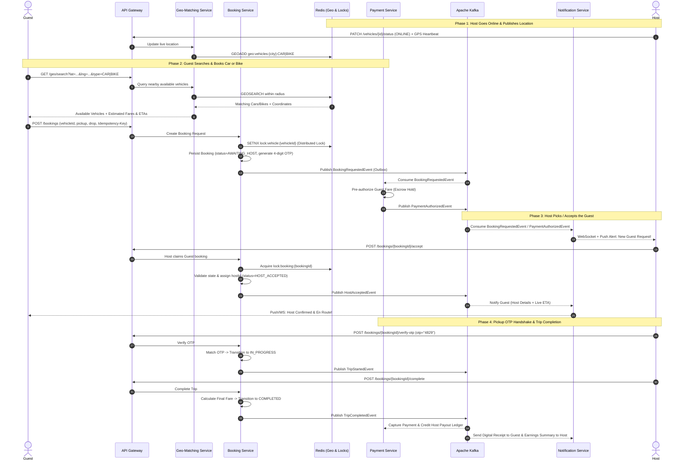

# Hopr — Distributed Mobility & P2P Vehicle Booking Platform (`hopr-springboot-app`)

**Hopr** is a cloud-native, event-driven microservices platform built with **Java** and **Spring Boot** that connects **Guests** (riders/renters looking to book a **Car** or **Bike**) with verified **Hosts** (vehicle owners/drivers who list their vehicles, accept incoming booking requests, and fulfill rides/rentals).

## Table of Contents

1. [System Architecture: HLD & LLD via The Four C's (C4 Model)](#1-system-architecture-hld--lld-via-the-four-cs-c4-model)
   * [Level 1: System Context (HLD)](#level-1-system-context-hld)
   * [Level 2: Containers & Microservices Topology (HLD)](#level-2-containers--microservices-topology-hld)
   * [Level 3: Component Architecture (LLD)](#level-3-component-architecture-lld)
   * [Level 4: Code & Domain Class Structure (LLD)](#level-4-code--domain-class-structure-lld)
2. [Microservices Deep-Dive (6 Core Architectural Parameters)](#2-microservices-deep-dive-6-core-architectural-parameters)
   * [2.1 API Gateway & Edge Service (`api-gateway`)](#21-api-gateway--edge-service-api-gateway)
   * [2.2 Identity, Auth & KYC Service (`auth-user-service`)](#22-identity-auth--kyc-service-auth-user-service)
   * [2.3 Vehicle & Fleet Inventory Service (`vehicle-service`)](#23-vehicle--fleet-inventory-service-vehicle-service)
   * [2.4 Geo-Search & Matching Service (`geo-matching-service`)](#24-geo-search--matching-service-geo-matching-service)
   * [2.5 Booking & Trip Lifecycle Service (`booking-service`)](#25-booking--trip-lifecycle-service-booking-service)
   * [2.6 Payment & Settlement Service (`payment-service`)](#26-payment--settlement-service-payment-service)
   * [2.7 Notification & Real-Time Event Service (`notification-service`)](#27-notification--real-time-event-service-notification-service)
3. [End-to-End Project Workflows](#3-end-to-end-project-workflows)
   * [3.1 Guest Workflow: How Anyone Books a Car or Bike](#31-guest-workflow-how-anyone-books-a-car-or-bike)
   * [3.2 Host Workflow: How a Registered Host Onboards & Picks/Accepts a Guest](#32-host-workflow-how-a-registered-host-onboards--picksaccepts-a-guest)
   * [3.3 End-to-End Sequence Diagram](#33-end-to-end-sequence-diagram)
4. [Design Patterns Used in the Project](#4-design-patterns-used-in-the-project)
   * [4.1 Java & Object-Oriented Design Patterns (GoF & Enterprise)](#41-java--object-oriented-design-patterns-gof--enterprise)
   * [4.2 Microservice & Distributed System Design Patterns](#42-microservice--distributed-system-design-patterns)
5. [API Reference Summary](#5-api-reference-summary)
6. [Project Structure & Local Setup](#6-project-structure--local-setup)

## 1. System Architecture: HLD & LLD via The Four C's (C4 Model)

The architecture of `hopr-springboot-app` is documented across **four hierarchical levels of abstraction** (Context, Containers, Components, and Code) to bridge high-level business capabilities with low-level Spring Boot implementation details.

### Level 1: System Context (HLD)

At the highest level of abstraction, **Hopr** sits at the center of a multi-sided mobility ecosystem serving three primary user personas and integrating with four external infrastructure providers.



### Level 2: Containers & Microservices Topology (HLD)

Zooming inside the **Hopr Platform** boundary reveals independently deployable Spring Boot microservices, edge routing, service discovery, distributed caching, relational storage, and an asynchronous Apache Kafka event backbone.



### Level 3: Component Architecture (LLD)

Zooming inside the **`booking-service`** and **`geo-matching-service`** illustrates the internal hexagonal/layered Spring Boot components, resilience wrappers, distributed lock managers, and transactional outbox publishers.



### Level 4: Code & Domain Class Structure (LLD)

At the code level, domain modeling enforces strict separation between **Cars** and **Bikes**, polymorphic pricing/matching strategies, and state-driven booking lifecycles.



## 2. Microservices Deep-Dive (6 Core Architectural Parameters)

Below is a comprehensive breakdown of every microservice in `hopr-springboot-app` evaluated across the **6 mandatory engineering parameters**.

### 2.1 API Gateway & Edge Service (`api-gateway`)

1. **Primary Purpose & Key Responsibilities**
   * Acts as the single unified ingress point for all Guest and Host mobile/web traffic.
   * Handles dynamic route resolution, SSL/TLS termination, JWT signature verification, role extraction (`ROLE_GUEST`, `ROLE_HOST`, `ROLE_ADMIN`), request header enrichment (`X-User-Id`, `X-User-Roles`, `X-Correlation-Id`), and distributed token-bucket rate limiting.

2. **Measuring Success (KPIs)**
   * **Gateway Overhead Latency:** $< 12\text{ ms}$ at $p_{99}$.
   * **Routing Availability:** $\ge 99.99\%$ uptime.
   * **Unauthorized Request Rejection Rate:** $100\%$ of expired/malformed JWTs blocked at the edge before reaching downstream services.
   * **Rate-Limit Accuracy:** $< 0.1\%$ false-positive throttling under normal traffic bursts.

3. **Data Flow, Response Times & Failure Impact**
   * **Inbound:** HTTPS/WSS requests from Guest/Host apps.
   * **Outbound:** Proxies synchronous HTTP/2 traffic to downstream microservices via Eureka service discovery and upgrades WebSocket connections to `notification-service`.
   * **Target Response Time:** $p_{50} < 5\text{ ms}$, $p_{99} < 15\text{ ms}$ (excluding downstream processing).
   * **Failure Impact:** **Critical (Single Entry Point).** If `api-gateway` goes down, external clients cannot reach any backend API. Mitigated by running multi-AZ active-active replicas behind a cloud Layer-7 Load Balancer (ALB/NLB).

4. **Technologies, Advantages & Limitations**
   * **Technologies:** Spring Cloud Gateway (Project Reactor / Netty non-blocking event loop), Redis RateLimiter, Spring Security OAuth2 Resource Server, Resilience4j.
   * **Advantages:** Non-blocking reactive I/O handles thousands of concurrent connections with minimal thread overhead; centralizes cross-cutting security and observability concerns.
   * **Limitations:** Incompatible with blocking servlet-based (`spring-boot-starter-web`) dependencies; custom filters must strictly avoid blocking calls or risk starving Netty event-loop threads.

5. **Scalability & Performance Targets**
   * **Throughput Target:** $15,000+\text{ requests/sec}$ per cluster.
   * **Scaling Strategy:** Horizontal Pod Autoscaling (HPA) triggered at $65\%$ CPU or network I/O saturation, scaling from $3$ to $25$ stateless instances.

6. **Security, Reliability & Compliance**
   * Enforces TLS 1.3, strict CORS policies, OWASP security headers, and Redis-backed sliding-window rate limits per IP/User ID to prevent DDoS and credential stuffing.
   * Propagates OpenTelemetry `traceparent` headers for end-to-end auditability.

### 2.2 Identity, Auth & KYC Service (`auth-user-service`)

1. **Primary Purpose & Key Responsibilities**
   * Manages user registration, authentication, JWT access/refresh token issuance, and dual-role profile management (a single user can act as a **Guest** and also onboard as a **Host**).
   * Orchestrates Host KYC verification (Driver's License validation, government ID checks, background approval status).

2. **Measuring Success (KPIs)**
   * **Authentication Latency:** $p_{95} < 80\text{ ms}$ for login/token refresh.
   * **KYC Verification Turnaround:** $< 5\text{ minutes}$ for automated document checks; $< 24\text{ hours}$ for manual review fallback.
   * **Token Validation Error Rate:** $< 0.01\%$.

3. **Data Flow, Response Times & Failure Impact**
   * **Inbound:** REST calls from `api-gateway` (`/api/v1/auth/**`, `/api/v1/users/**`).
   * **Outbound:** Reads/writes to `auth_db` (PostgreSQL), stores refresh token blacklists in Redis, calls external KYC APIs asynchronously, and publishes `HostVerifiedEvent` / `UserRegisteredEvent` to Kafka.
   * **Target Response Time:** $p_{50} < 35\text{ ms}$, $p_{99} < 120\text{ ms}$.
   * **Failure Impact:** **High for new logins/registrations; Low for active sessions.** Existing authenticated Guests/Hosts continue operating seamlessly because `api-gateway` validates stateless asymmetric RS256 JWTs locally via cached public JWKS keys.

4. **Technologies, Advantages & Limitations**
   * **Technologies:** Spring Boot Web, Spring Security, JJWT (RS256 asymmetric keys), PostgreSQL (`auth_db`), Redis, Apache Kafka, MapStruct.
   * **Advantages:** Stateless RS256 JWT verification eliminates synchronous auth bottlenecks across microservices; clean role separation (`ROLE_GUEST`, `ROLE_HOST`).
   * **Limitations:** Immediate revocation of compromised access tokens requires maintaining a short-lived Redis denylist until token TTL expiration.

5. **Scalability & Performance Targets**
   * **Throughput Target:** $3,000\text{ auth/profile ops/sec}$.
   * **Scaling Strategy:** Stateless horizontal scaling ($2$ to $12$ pods) backed by HikariCP connection pooling and PostgreSQL read replicas for profile lookups.

6. **Security, Reliability & Compliance**
   * Passwords hashed with **BCrypt (strength 12)**; PII (phone numbers, license numbers) encrypted at rest using AES-256-GCM column encryption.
   * Compliant with **GDPR** and **India DPDP Act** (consent tracking, right-to-erasure soft/hard anonymization workflows, audit logs for all KYC status changes).

### 2.3 Vehicle & Fleet Inventory Service (`vehicle-service`)

1. **Primary Purpose & Key Responsibilities**
   * Serves as the system of record for all **Cars** and **Bikes** registered by Hosts.
   * Manages vehicle onboarding (make, model, registration plate, RC/insurance expiry dates, category: `CAR` vs. `BIKE`), availability status (`ONLINE`, `OFFLINE`, `BOOKED`, `MAINTENANCE`), and dynamic pricing rules.

2. **Measuring Success (KPIs)**
   * **Fleet Onboarding Completion Rate:** $> 85\%$ of Hosts who start vehicle registration complete verification.
   * **Inventory State Consistency:** $100\%$ synchronization between vehicle availability status and active bookings.
   * **Catalog Read Latency:** $p_{95} < 40\text{ ms}$.

3. **Data Flow, Response Times & Failure Impact**
   * **Inbound:** REST requests from Hosts managing vehicles; internal queries from `booking-service` and `geo-matching-service`.
   * **Outbound:** Persists to `vehicle_db`, caches hot vehicle metadata in Redis, and emits `VehicleStatusChangedEvent` / `VehicleRegisteredEvent` to Kafka whenever a Host toggles availability or updates location.
   * **Target Response Time:** $p_{50} < 20\text{ ms}$, $p_{99} < 65\text{ ms}$.
   * **Failure Impact:** **Medium-High.** New vehicle listings and status toggles pause, but active in-progress trips remain unaffected; `geo-matching-service` can still serve cached vehicle snapshots from Redis during brief outages.

4. **Technologies, Advantages & Limitations**
   * **Technologies:** Spring Boot, Spring Data JPA (Single-Table / Joined Inheritance for `Vehicle` $\rightarrow$ `Car` / `Bike`), PostgreSQL + PostGIS, Redis Cache, Kafka.
   * **Advantages:** Strongly typed inheritance model cleanly separates Car attributes (seats, fuel, trunk) from Bike attributes (engine CC, helmet availability) while sharing core booking contracts.
   * **Limitations:** High write frequency if GPS pings are written directly to PostgreSQL; mitigated by routing high-frequency GPS telemetry exclusively to Redis in `geo-matching-service` and persisting only state transitions to `vehicle_db`.

5. **Scalability & Performance Targets**
   * **Throughput Target:** $5,000\text{ reads/sec}$, $1,200\text{ writes/sec}$.
   * **Scaling Strategy:** Cache-aside pattern in Redis (TTL $10\text{ min}$ with event-driven invalidation) achieves $> 92\%$ cache hit ratio; database partitioned by `city_zone_id`.

6. **Security, Reliability & Compliance**
   * Enforces ownership authorization (`@PreAuthorize("@vehicleSecurity.isOwner(#vehicleId, authentication.name)")`) so Hosts can only modify their own vehicles.
   * Automated scheduled jobs flag and auto-offline vehicles with expired insurance or pollution/registration certificates to ensure regulatory road-safety compliance.

### 2.4 Geo-Search & Matching Service (`geo-matching-service`)

1. **Primary Purpose & Key Responsibilities**
   * Powers real-time spatial discovery so Guests can find nearby **Cars** and **Bikes** within a configurable radius (e.g., $1\text{ km} - 10\text{ km}$).
   * Ingests live Host/vehicle GPS heartbeats, computes ETA and distance matrices, applies surge multipliers based on supply-demand density, and ranks candidate Hosts for incoming booking requests.

2. **Measuring Success (KPIs)**
   * **Search Query Latency:** $p_{95} < 30\text{ ms}$, $p_{99} < 60\text{ ms}$ for radius queries across $100,000+$ active vehicles.
   * **Match Success Rate:** $> 94\%$ of Guest search requests yield at least one available Car/Bike within $5\text{ minutes}$ ETA.
   * **Location Freshness:** Vehicle coordinates updated every $3 - 5\text{ seconds}$ while Host is `ONLINE`.

3. **Data Flow, Response Times & Failure Impact**
   * **Inbound:** Guest search requests (`GET /api/v1/geo/search`), Host GPS heartbeat pings (`POST /api/v1/geo/heartbeat`), and `VehicleStatusChangedEvent` from Kafka.
   * **Outbound:** Queries Redis Geospatial indexes (`GEOADD`, `GEOSEARCH`) and external Maps Distance Matrix API (with local Haversine fallback).
   * **Target Response Time:** $p_{50} < 15\text{ ms}$, $p_{99} < 50\text{ ms}$.
   * **Failure Impact:** **High for new bookings.** Guests cannot discover nearby vehicles if Redis Geo is unreachable. Mitigated via Redis Cluster with automatic sentinel failover and a fallback spatial query against PostGIS `GIST` indexes in `vehicle_db`.

4. **Technologies, Advantages & Limitations**
   * **Technologies:** Spring Boot, Spring Data Redis (`GeoOperations`), Geohash / S2 Geometry indexing, Resilience4j (Circuit Breaker on external Maps API), Kafka.
   * **Advantages:** In-memory Redis `GEOSEARCH` delivers sub-10ms radius lookups at massive concurrency; Haversine mathematical fallback guarantees zero dependency outage if external Maps APIs throttle.
   * **Limitations:** Redis memory footprint grows linearly with active online vehicles and historical trail retention; solved by storing only current live coordinates with a $30\text{-second}$ TTL auto-eviction for disconnected Hosts.

5. **Scalability & Performance Targets**
   * **Throughput Target:** $20,000+\text{ GPS heartbeat writes/sec}$ and $8,000\text{ geo-search queries/sec}$.
   * **Scaling Strategy:** Redis Cluster sharded by geographic city/region key (`geo:vehicles:{cityCode}:CAR` and `geo:vehicles:{cityCode}:BIKE`), enabling lock-free parallel reads across Car and Bike pools.

6. **Security, Reliability & Compliance**
   * Spoof-detection heuristics reject impossible GPS velocity jumps (e.g., $> 180\text{ km/h}$ teleportation) to prevent Host location spoofing.
   * Exact Host GPS coordinates are obfuscated/fuzzed prior to booking confirmation to protect Host privacy.

### 2.5 Booking & Trip Lifecycle Service (`booking-service`)

1. **Primary Purpose & Key Responsibilities**
   * Core transactional engine managing the end-to-end lifecycle of a Car or Bike booking from creation to completion.
   * Enforces concurrency control (preventing double-booking of the same vehicle or two Hosts claiming the same ride), manages the **Booking State Machine**, generates/validates the 4-digit **Pickup OTP**, and coordinates distributed Saga workflows across Payment, Vehicle, and Notification services.

2. **Measuring Success (KPIs)**
   * **Double-Booking Rate:** $0.00\%$ (strictly zero overlapping bookings per vehicle).
   * **Booking Creation Latency:** $p_{95} < 150\text{ ms}$.
   * **Host Acceptance Time:** Median $< 18\text{ seconds}$ from Guest request to Host pickup acceptance.
   * **Saga Completion Consistency:** $100\%$ eventual consistency across Payment and Vehicle states.

3. **Data Flow, Response Times & Failure Impact**
   * **Inbound:** Guest booking requests, Host accept/reject actions, OTP verification, trip start/complete commands, and `PaymentAuthorizedEvent` / `PaymentFailedEvent` from Kafka.
   * **Outbound:** Writes to `booking_db` (PostgreSQL), acquires distributed locks in Redis, calls `vehicle-service` / `geo-matching-service`, and publishes lifecycle events (`BookingRequestedEvent`, `HostAcceptedEvent`, `TripStartedEvent`, `TripCompletedEvent`) via the **Transactional Outbox**.
   * **Target Response Time:** $p_{50} < 65\text{ ms}$, $p_{99} < 180\text{ ms}$.
   * **Failure Impact:** **Critical for new bookings and active state transitions.** Mitigated by multi-replica deployment, database connection pooling, and idempotency keys (`Idempotency-Key` header) so mobile clients can safely retry failed network requests without duplicate bookings.

4. **Technologies, Advantages & Limitations**
   * **Technologies:** Spring Boot, Spring Data JPA (Optimistic Locking via `@Version`), Redisson (Distributed Locks), Spring StateMachine / Enum State Pattern, PostgreSQL (`booking_db`), Apache Kafka, Resilience4j.
   * **Advantages:** Dual-layer locking (Redisson distributed lock + JPA `@Version` optimistic lock) eliminates race conditions during high-demand peak hours; Transactional Outbox prevents dual-write data loss.
   * **Limitations:** Distributed Saga compensation adds complexity when downstream payment holds fail after a Host accepts; handled cleanly via deterministic compensating state transitions (`CANCELLED_PAYMENT_FAILED`).

5. **Scalability & Performance Targets**
   * **Throughput Target:** $2,500\text{ booking state transitions/sec}$.
   * **Scaling Strategy:** Stateless microservice instances ($3$ to $20$ pods); `booking_db` partitioned by `created_at` (monthly range partitions) and indexed on `(guest_id, status)` and `(host_id, status)`.

6. **Security, Reliability & Compliance**
   * Strict role-based state transition guards: only the assigned `hostId` can invoke `/accept` or `/verify-otp`, and only the `guestId` or assigned `hostId` can trigger authorized cancellation workflows.
   * Immutable `booking_audit_log` records every state transition, timestamp, actor ID, and GPS coordinate for dispute resolution and legal compliance.

### 2.6 Payment & Settlement Service (`payment-service`)

1. **Primary Purpose & Key Responsibilities**
   * Handles fare pre-authorization (escrow hold) when a Guest books a Car or Bike, final fare capture upon trip completion, cancellation fee calculation, refunds, and automated split-payout ledger entries for Hosts (net of platform commission).

2. **Measuring Success (KPIs)**
   * **Payment Authorization Success Rate:** $> 98.5\%$ (excluding user insufficient-funds declines).
   * **Webhook Processing Latency:** $p_{95} < 100\text{ ms}$.
   * **Ledger Reconciliation Accuracy:** $100.00\%$ zero-discrepancy double-entry accounting.

3. **Data Flow, Response Times & Failure Impact**
   * **Inbound:** Consumes `BookingRequestedEvent`, `TripCompletedEvent`, and `BookingCancelledEvent` from Kafka; receives asynchronous signed webhooks from Stripe/Razorpay.
   * **Outbound:** Calls external Payment Gateway APIs, persists double-entry ledger records in `payment_db`, and emits `PaymentAuthorizedEvent`, `PaymentCapturedEvent`, or `PaymentRefundedEvent` to Kafka.
   * **Target Response Time:** Internal ledger ops $p_{95} < 40\text{ ms}$; external gateway calls bounded by $3,000\text{ ms}$ timeout with retry/circuit breaker.
   * **Failure Impact:** **High for booking confirmation and settlement.** If the external payment gateway experiences downtime, circuit breakers trip immediately and allow configured fallback payment methods (e.g., Hopr Wallet balance or Cash-on-Pickup for verified Guests) so rides are not blocked.

4. **Technologies, Advantages & Limitations**
   * **Technologies:** Spring Boot, PostgreSQL (`payment_db` with `SERIALIZABLE` / `REPEATABLE_READ` isolation for wallet balances), Spring Retry, Resilience4j, Kafka.
   * **Advantages:** Double-entry immutable ledger guarantees financial auditability; idempotency keys prevent double-charging on webhook retries.
   * **Limitations:** Cross-border or bank payout settlements are asynchronous ($T+1$ / $T+2$ days depending on banking rails), requiring clear `PENDING_SETTLEMENT` vs. `SETTLED` ledger states.

5. **Scalability & Performance Targets**
   * **Throughput Target:** $1,500\text{ financial transactions/sec}$.
   * **Scaling Strategy:** Kafka consumer groups partitioned by `bookingId` ensure strict ordering of payment events for a given trip while scaling consumers horizontally.

6. **Security, Reliability & Compliance**
   * **PCI-DSS Compliant:** Raw credit/debit card numbers never touch Hopr servers; only tokenized payment methods (`pm_xxx`) from Stripe/Razorpay are stored.
   * All incoming payment gateway webhooks undergo HMAC-SHA256 cryptographic signature verification before processing.

### 2.7 Notification & Real-Time Event Service (`notification-service`)

1. **Primary Purpose & Key Responsibilities**
   * Delivers sub-second real-time alerts to Hosts when a nearby Guest requests a Car or Bike, and streams live booking status updates, Host ETA, and 4-digit Pickup OTPs to Guests.
   * Orchestrates multi-channel delivery across **WebSockets (STOMP)**, **Push Notifications (FCM/APNs)**, **SMS**, and **Email**.

2. **Measuring Success (KPIs)**
   * **Real-Time Alert Dispatch Latency:** $p_{95} < 250\text{ ms}$ from `BookingRequestedEvent` creation to Host screen alert.
   * **Notification Delivery Rate:** $> 99.5\%$ across primary channels.
   * **WebSocket Connection Stability:** $< 0.5\%$ unexpected drop rate per hour.

3. **Data Flow, Response Times & Failure Impact**
   * **Inbound:** Purely event-driven consumer subscribing to Kafka topics (`booking.events`, `payment.events`, `auth.events`); maintains persistent WebSocket sessions via `api-gateway`.
   * **Outbound:** Pushes frames over active WebSocket/STOMP channels, calls Firebase FCM / Twilio SMS APIs, and logs delivery receipts.
   * **Target Response Time:** $p_{50} < 80\text{ ms}$, $p_{99} < 300\text{ ms}$.
   * **Failure Impact:** **Low-Medium (Graceful Degradation).** Core booking transactions continue safely in Kafka; if WebSocket delivery fails, the service automatically falls back to FCM Push Notification and SMS so Hosts never miss a booking request and Guests always receive their OTP.

4. **Technologies, Advantages & Limitations**
   * **Technologies:** Spring Boot WebSocket (STOMP over SockJS), Redis Pub/Sub (for cross-instance WebSocket session routing), Apache Kafka, Firebase Admin SDK, Twilio SDK.
   * **Advantages:** Decoupled from synchronous request paths; Redis Pub/Sub allows any pod to route a real-time message to a Host connected to a different pod.
   * **Limitations:** Stateful WebSocket connections require sticky-session awareness or Redis Pub/Sub fan-out and careful memory tuning (`-Xmx` and netty buffer limits) at high connection counts.

5. **Scalability & Performance Targets**
   * **Throughput Target:** $50,000+\text{ concurrent WebSocket sessions}$ and $5,000\text{ push/SMS notifications/sec}$.
   * **Scaling Strategy:** Horizontal scaling with Redis Pub/Sub message broker relay (`SimpleBroker` / external RabbitMQ/Redis relay) for seamless cross-node STOMP message delivery.

6. **Security, Reliability & Compliance**
   * WebSocket `CONNECT` frames validate JWT tokens and bind sessions strictly to `principal.getName()` (`userId`), preventing cross-user eavesdropping on private STOMP topics (`/user/queue/bookings`).
   * Sensitive OTP logs are masked (`****`) in application logs to prevent internal credential leakage.

## 3. End-to-End Project Workflows

### 3.1 Guest Workflow: How Anyone Books a Car or Bike

1. **Account Creation & Login:**
   * A new user signs up via `POST /api/v1/auth/register` with role `ROLE_GUEST` (or logs in via `POST /api/v1/auth/login`) and receives a signed JWT access token.

2. **Location & Vehicle Discovery (`CAR` or `BIKE`):**
   * The Guest opens the app, sets their **Pickup Location** and **Drop Location** (or rental duration), and selects their preferred vehicle category: **`CAR`** or **`BIKE`**.
   * The client calls `GET /api/v1/geo/search?lat=22.5726&lng=88.3639&radiusKm=5&vehicleType=BIKE`.
   * `geo-matching-service` queries Redis Geo (`geo:vehicles:{city}:BIKE`), filters out offline or busy vehicles, computes estimated distance/duration, and invokes `BikePricingStrategy` (or `CarPricingStrategy`) to return available vehicles along with upfront fare estimates and ETAs.

3. **Initiating the Booking & Acquiring Distributed Lock:**
   * The Guest selects a vehicle (or triggers an instant on-demand match) and sends `POST /api/v1/bookings` with an `Idempotency-Key`.
   * `booking-service` acquires a **Redisson distributed lock** (`lock:vehicle:{vehicleId}`) for $10\text{ seconds}$ to guarantee no two Guests can book the same Car or Bike simultaneously.
   * A `Booking` record is persisted in PostgreSQL with status **`REQUESTED`** (or **`PENDING_PAYMENT`**) and a randomly generated **4-digit Pickup OTP**.

4. **Payment Pre-Authorization (Escrow Hold):**
   * `booking-service` publishes `BookingRequestedEvent` via the Transactional Outbox to Kafka.
   * `payment-service` places a pre-authorization hold for the estimated fare on the Guest's selected payment method and emits `PaymentAuthorizedEvent`.
   * `booking-service` transitions the booking status to **`AWAITING_HOST_ACCEPTANCE`**.

5. **Real-Time Host Matching & Confirmation:**
   * `notification-service` pushes an instant booking alert (via WebSocket + FCM Push) to the target Host (for P2P vehicle selection) or broadcasts to the top-ranked nearby Hosts matching `CAR`/`BIKE`.
   * Once a Host accepts, the booking transitions to **`HOST_ACCEPTED`**, and the Guest receives the Host's name, rating, vehicle registration number, live GPS tracking stream, and their **4-digit Pickup OTP**.

6. **OTP Handshake, Ride Execution & Completion:**
   * When the Host arrives at the pickup point (or meets the Guest for vehicle handover), the Guest shares their **4-digit OTP**.
   * Once verified, the trip transitions to **`IN_PROGRESS`**.
   * Upon reaching the destination / returning the vehicle, the trip transitions to **`COMPLETED`**, `payment-service` captures the final fare, and both Guest and Host rate each other.

### 3.2 Host Workflow: How a Registered Host Onboards & Picks/Accepts a Guest

1. **Host Registration & KYC Verification:**
   * A registered user upgrades to a Host (or registers directly with `ROLE_HOST`) via `POST /api/v1/hosts/onboard`.
   * The Host submits their **Driver's License**, government ID, and bank/payout details. `auth-user-service` verifies the documents and updates `kycStatus` to **`VERIFIED`**.

2. **Registering a Car or Bike:**
   * The verified Host registers their vehicle via `POST /api/v1/vehicles`, specifying:
     * `vehicleType`: **`CAR`** (e.g., Sedan, Hatchback, SUV, seating capacity, fuel type) or **`BIKE`** (e.g., Scooter, Commuter, Cruiser, engine CC, extra helmet provided).
     * `registrationNumber`, RC document, insurance validity, and base pricing preferences.

3. **Going Online & Broadcasting Location:**
   * When ready to accept Guests, the Host toggles their status to **`ONLINE`** (`PATCH /api/v1/vehicles/{vehicleId}/status?status=ONLINE`).
   * The Host app streams periodic GPS heartbeats (`POST /api/v1/geo/heartbeat`) every $3 - 5\text{ seconds}$, indexing the Host's live coordinates into Redis Geo so nearby Guests searching for a Car or Bike can discover them.

4. **Receiving & Picking/Accepting a Guest Request:**
   * When a nearby Guest books a Car or Bike, `notification-service` delivers a real-time alert over WebSocket (`/user/queue/booking-requests`) containing:
     * Pickup & drop locations, distance to Guest, trip distance, vehicle category (`CAR`/`BIKE`), and estimated Host payout.
   * **How the Host Picks the Guest:** The Host taps **"Accept / Pick Guest"**, invoking `POST /api/v1/bookings/{bookingId}/accept`.
   * Inside `booking-service`:
     1. A **Redisson distributed lock** (`lock:booking:{bookingId}`) + JPA optimistic locking (`@Version`) ensures **atomic first-win claim**—if multiple Hosts were notified for an on-demand ride, only the first Host to accept claims the Guest, while concurrent requests receive `409 Conflict (Booking already claimed)`.
     2. The booking updates `hostId = {currentHostId}` and transitions state from `AWAITING_HOST_ACCEPTANCE` $\rightarrow$ **`HOST_ACCEPTED`**.
     3. `vehicle-service` marks the Host's Car/Bike as **`BOOKED`** so they are temporarily removed from new Guest search results.

5. **Navigating to Pickup & Verifying Guest OTP:**
   * The Host navigates to the Guest's pickup pin, meets the Guest, and enters the Guest's **4-digit Pickup OTP** via `POST /api/v1/bookings/{bookingId}/verify-otp`.
   * `booking-service` validates the OTP and transitions the trip to **`IN_PROGRESS`**.

6. **Completing the Trip & Receiving Payout:**
   * At trip end, the Host invokes `POST /api/v1/bookings/{bookingId}/complete` with final odometer/GPS distance.
   * `booking-service` transitions to **`COMPLETED`**, `vehicle-service` returns the Car/Bike status to **`ONLINE`** (ready for the next Guest), and `payment-service` credits the Host's net earnings (Fare $-$ Platform Fee) to their settlement ledger.

### 3.3 End-to-End Sequence Diagram



## 4. Design Patterns Used in the Project

### 4.1 Java & Object-Oriented Design Patterns (GoF & Enterprise)

| Pattern | Where Used in `hopr-springboot-app` | Architectural Benefit |
| :--- | :--- | :--- |
| **Strategy Pattern** | `PricingStrategy` (`CarPricingStrategy`, `BikePricingStrategy`, `SurgePricingStrategy`) & `MatchingStrategy` (`NearestHostStrategy`, `TopRatedHostStrategy`) | Dynamically switches fare formulas and Host ranking algorithms at runtime based on `VehicleType` (`CAR` vs. `BIKE`) without `if-else` chains. |
| **State Pattern** | `BookingState` (`RequestedState`, `HostAcceptedState`, `InProgressState`, `CompletedState`, `CancelledState`) | Encapsulates legal state transitions inside `Booking`, preventing invalid actions (e.g., starting a trip without OTP verification or accepting a cancelled booking). |
| **Factory Method / Abstract Factory** | `VehicleFactory` & `NotificationChannelFactory` | Instantiates specialized domain validators and metadata builders for `Car` vs. `Bike` and dispatches notifications across WebSocket, FCM, or SMS. |
| **Facade Pattern** | `BookingOrchestrationFacade` | Provides a clean, single entry point for controllers while coordinating distributed locking, geo-validation, fare estimation, and persistence underneath. |
| **Builder Pattern** | Domain Entities (`Booking.builder()`, `Vehicle.builder()`), DTOs, and `ApiResponse<T>` | Ensures immutable, readable construction of complex objects with optional attributes (such as bike helmet count vs. car seating capacity). |
| **Observer / Domain Event Pattern** | Spring `ApplicationEventPublisher` & `@TransactionalEventListener` | Decouples core database commits from side effects such as writing audit trails, updating metrics, and staging Outbox events. |
| **Template Method Pattern** | `AbstractPaymentGatewayAdapter` | Defines the invariant payment execution skeleton (`validate()` $\rightarrow$ `signRequest()` $\rightarrow$ `executeCall()` $\rightarrow$ `mapResponse()`) across different payment providers. |
| **Repository & Mapper Pattern** | Spring Data JPA Repositories + MapStruct Mappers | Isolates relational persistence schemas from public REST request/response DTOs. |

### 4.2 Microservice & Distributed System Design Patterns

| Pattern | Implementation in `hopr-springboot-app` | Problem Solved |
| :--- | :--- | :--- |
| **API Gateway Pattern** | `api-gateway` (Spring Cloud Gateway) | Single entry point handling JWT auth, routing, CORS, and Redis-backed rate limiting. |
| **Service Discovery Pattern** | Netflix Eureka (`service-registry`) | Enables dynamic horizontal scaling without hardcoded service hostnames or ports. |
| **Database-per-Service** | Separate PostgreSQL schemas (`auth_db`, `vehicle_db`, `booking_db`, `payment_db`) | Guarantees loose coupling, independent schema migrations (Flyway), and isolated failure domains. |
| **Saga Pattern (Choreography)** | Kafka event choreography across `booking-service`, `payment-service`, and `vehicle-service` | Coordinates distributed multi-service transactions with compensating rollbacks (e.g., auto-releasing vehicle lock if payment authorization fails). |
| **Transactional Outbox Pattern** | `outbox_events` table written inside the same local ACID transaction as `bookings` | Eliminates the dual-write problem, guaranteeing **at-least-once** Kafka event delivery even if the broker is momentarily unreachable. |
| **Distributed Locking** | Redisson (`RLock`) on `vehicle:{id}` and `booking:{id}` | Prevents race conditions such as two Guests booking the same vehicle or two Hosts simultaneously accepting the same ride. |
| **Circuit Breaker, Retry & Bulkhead** | Resilience4j annotations (`@CircuitBreaker`, `@Retry`, `@Bulkhead`) | Prevents cascading latency when external Maps or Payment APIs degrade, providing fast fallbacks (e.g., Haversine distance fallback). |
| **CQRS (Command Query Separation)** | Geo-search queries served from Redis Geo read-models while booking mutations execute on PostgreSQL | Optimizes high-frequency spatial reads ($20\text{k+ ops/sec}$) independently from ACID booking writes. |
| **Idempotent Consumer / API** | `Idempotency-Key` header + `processed_events` deduplication table | Ensures safe network retries from mobile clients and duplicate Kafka message deliveries never cause double bookings or double charges. |
| **Centralized Config & Distributed Tracing** | Spring Cloud Config + Micrometer / OpenTelemetry + Zipkin | Externalizes environment secrets/configs and correlates logs across all microservices via `traceId` and `spanId`. |

## 5. API Reference Summary

### Authentication & Host Onboarding (`auth-user-service`)

| Method | Endpoint | Role | Description |
| :--- | :--- | :--- | :--- |
| `POST` | `/api/v1/auth/register` | Public | Register a new user (`ROLE_GUEST` / `ROLE_HOST`) |
| `POST` | `/api/v1/auth/login` | Public | Authenticate and obtain RS256 JWT Access & Refresh tokens |
| `POST` | `/api/v1/hosts/onboard` | `GUEST` | Submit Driver's License & KYC documents to become a verified Host |

### Vehicle Management & Geo-Discovery (`vehicle-service` & `geo-matching-service`)

| Method | Endpoint | Role | Description |
| :--- | :--- | :--- | :--- |
| `POST` | `/api/v1/vehicles` | `HOST` | Register a new **Car** or **Bike** with pricing & specs |
| `PATCH` | `/api/v1/vehicles/{vehicleId}/status` | `HOST` | Toggle vehicle availability (`ONLINE` / `OFFLINE`) |
| `POST` | `/api/v1/geo/heartbeat` | `HOST` | Stream real-time Host GPS coordinates to Redis Geo |
| `GET` | `/api/v1/geo/search` | `GUEST` | Discover nearby available Cars or Bikes with fare estimates |

### Booking & Trip Execution (`booking-service`)

| Method | Endpoint | Role | Description |
| :--- | :--- | :--- | :--- |
| `POST` | `/api/v1/bookings` | `GUEST` | Book a Car or Bike (acquires distributed lock & initiates Saga) |
| `POST` | `/api/v1/bookings/{bookingId}/accept` | `HOST` | **Pick/Accept** an incoming Guest booking request |
| `POST` | `/api/v1/bookings/{bookingId}/verify-otp` | `HOST` | Verify Guest's 4-digit Pickup OTP to start the ride |
| `POST` | `/api/v1/bookings/{bookingId}/complete` | `HOST` | Complete the trip, trigger fare capture & Host payout |
| `POST` | `/api/v1/bookings/{bookingId}/cancel` | `GUEST`/`HOST` | Cancel booking and trigger Saga compensation/refunds |

## 6. Project Structure & Local Setup

### Repository Module Layout

```text
hopr-springboot-app/
├── service-registry/          # Eureka Discovery Server (:8761)
├── config-server/             # Spring Cloud Config Server (:8888)
├── api-gateway/               # Reactive Edge Gateway & JWT Filter (:8080)
├── auth-user-service/         # Users, Roles (Guest/Host), KYC & JWT (:8081)
├── vehicle-service/           # Car & Bike Fleet Management (:8082)
├── geo-matching-service/      # Redis Geo Search, ETA & Pricing Engine (:8083)
├── booking-service/           # Booking State Machine, Locks & Saga (:8084)
├── payment-service/           # Escrow Pre-Auth, Capture & Host Ledger (:8085)
├── notification-service/      # WebSockets (STOMP), FCM Push & SMS (:8086)
├── docker-compose.yml         # PostgreSQL, Redis, Kafka, Zookeeper, Zipkin
└── pom.xml                    # Multi-module Maven Parent POM
```

### Quick Start (Local Development)

1. **Clone the Repository:**
   ```bash
   git clone https://github.com/coder-stat920715/hopr-springboot-app.git
   cd hopr-springboot-app
   ```

2. **Start Infrastructure Dependencies (PostgreSQL, Redis, Apache Kafka, Zipkin):**
   ```bash
   docker-compose up -d
   ```

3. **Build All Microservices:**
   ```bash
   mvn clean install -DskipTests
   ```

4. **Start Core Services in Order:**
   ```bash
   # 1. Service Registry & Config Server
   mvn -pl service-registry spring-boot:run &
   mvn -pl config-server spring-boot:run &

   # 2. API Gateway & Domain Microservices
   mvn -pl api-gateway spring-boot:run &
   mvn -pl auth-user-service,vehicle-service,geo-matching-service,booking-service,payment-service,notification-service spring-boot:run
   ```

5. **Verify Health & Service Registration:**
   * **Eureka Dashboard:** `http://localhost:8761`
   * **API Gateway Health:** `http://localhost:8080/actuator/health`
   * **Distributed Tracing (Zipkin):** `http://localhost:9411`

---

## v2 features (Host Quick Actions, device guard, appeals, locked corporate profile)

### New demo accounts (dev, OTP `123456`)
| Phone | Who |
|---|---|
| +919038577517 | **Souptik Tat** - Kolkata, Cognizant (`souptik.tat@cognizant.com`), company **locked**, bound to `DEVICE-SOUPTIK-001` |
| +919000000008 | **Kiran Rao** - Hyderabad bike host (Gowlidoddy <-> Capgemini Nanakramguda), has 2 pending Quick Action requests |
| +919000000009 | **Rajan Dutta** - TCS guest, pending request: `19 m -> 19.4 km -> 498 m`, `Rs 79 -> Rs 90`, `> 80% match` |
| +919000000010 | **Neha Sharma** - 99acres guest, second pending request |

### 1. Host mode & Quick Action
| Endpoint | Purpose |
|---|---|
| `PATCH /api/v1/users/active-mode` `{"mode":"HOST"}` | persist mode + dashboard (fuel cost recovered, seats published, pending quick actions) |
| `GET /api/v1/host/quick-actions` | `Quick action (N)` cards: guest + corporate badge, timing comparison, walk-and-ride, base/dynamic fare + trend, match label |
| `GET /api/v1/host/dashboard` | host metrics |
| `PATCH /api/v1/bookings/{id}/respond` | accept / reject (optimistic locking on the ride) |
| `POST/GET /api/v1/bookings/{id}/chat` | pre-acceptance chat (also STOMP `/topic/bookings/{id}`) |
| `POST /api/v1/bookings/{id}/masked-call` | privacy-masked call bridge |

Dynamic pricing (`hopr.pricing.dynamic.*`): peak-hour surcharge, route-detour surcharge, last-seat scarcity surcharge, off-peak discount on an empty ride. The **dynamic fare is the amount held in escrow and paid out**; `discountedFare` is the base.
`POST /bookings/request` accepts an optional `preferredDepartureTime`.

### 2. Device account limit guard
`POST /auth/send-otp` and `/auth/verify-otp` accept `deviceId` (+ `deviceModel`, `osPlatform`) in the body or the `X-Device-Id` header. `hopr.security.max-accounts-per-device` (default 1). A second phone number on a bound device gets **HTTP 403** with `errorCode: DEVICE_ACCOUNT_LIMIT_REACHED`, `ctaButtonText: "Submit an appeal"`, `externalAppealUrl`, `internalAppealEndpoint`, `appealWebFormUrl`.

### 3. Appeals (public, no JWT)
* `POST /api/v1/appeals/submit` - `multipart/form-data` (fields + `screenshots[]`, max 5 files, 5 MB, PNG/JPG/GIF/WEBP/PDF) **or** `application/json`. Fields mirror the Zoho form: name, phone, city (HYDERABAD, KOLKATA, BENGALURU, MUMBAI, PUNE, CHENNAI, DELHI_NCR), profile type (`Host - Ride Giver` / `Guest - Ride Taker`), previous phone, issue (10-20000 chars), optional `deviceId`. Ticket format `HPR-APL-2026-0001`.
* `GET /api/v1/appeals/status/{ticket}`, `GET /api/v1/appeals/config`.
* Admin: `GET /api/v1/admin/appeals`, `GET /api/v1/admin/appeals/{id}`, `POST /api/v1/admin/appeals/{id}/resolve`
```json
{"decision":"APPROVED","adminRemarks":"Verified","unlockDeviceLimit":true,"unlockCompanyAndEmail":true,"targetCity":"HYDERABAD"}
```
Screenshots are stored under `hopr.appeals.upload-dir` (default `uploads/appeals`).

### 4. Locked corporate profile & employer/city migration
* `User.companyLocked` (true once a corporate e-mail is verified), `corporateEmailLocked`, `corporateLockReason`; archive table `UserCorporateHistory`.
* `POST /api/v1/users/company-change/request` `{newCompanyName,newCorporateEmail,newCity}` -> **423 `COMPANY_UPDATE_LOCKED`** (with `prefilledAppeal`) while locked; otherwise OTP to the new corporate e-mail (domain must be allow-listed and match the company).
* `POST /api/v1/users/company-change/verify-otp` -> archives the old affiliation, switches company / e-mail / city, re-locks, archives old commutes and (for Capgemini Hyderabad) creates `Gowlidoddy <-> Capgemini Nanakramguda` placeholders.
* The original `company-change/initiate|verify` endpoints still work and ignore the lock.

### 5. Visual test pages (static, served by Spring Boot)
`/host-quick-actions.html`, `/appeal-form.html`, `/profile-migration.html` (open `http://localhost:8080/...`).

### Notes
* `RideService.migrateCitySchedules` now cancels **all** upcoming rides of the host (not only template-generated ones).
* Postman: `postman/hopr-postman-collection.json` (174 requests) - folders 9-13 cover the new features.


## Testing & coverage
`mvn clean verify` runs the JUnit/Mockito/MockMvc suite and writes the JaCoCo report to `target/site/jacoco/index.html`.
See `docs/TEST_COVERAGE.md` for the class-to-test map and how to enforce a 100 % gate (`-Djacoco.minimum=1.00`).
